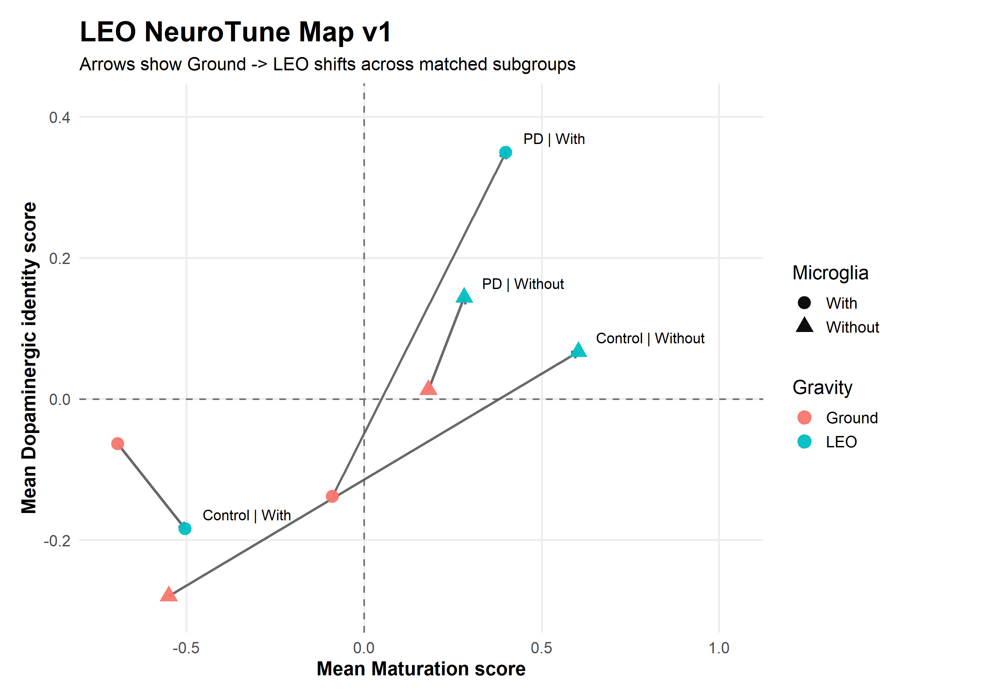
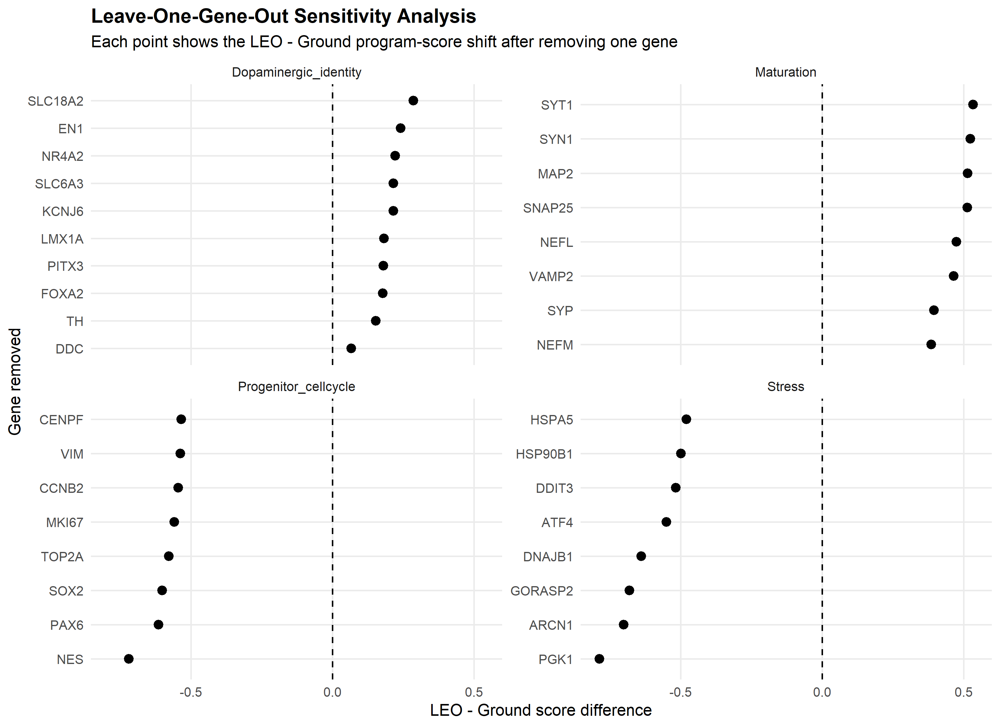
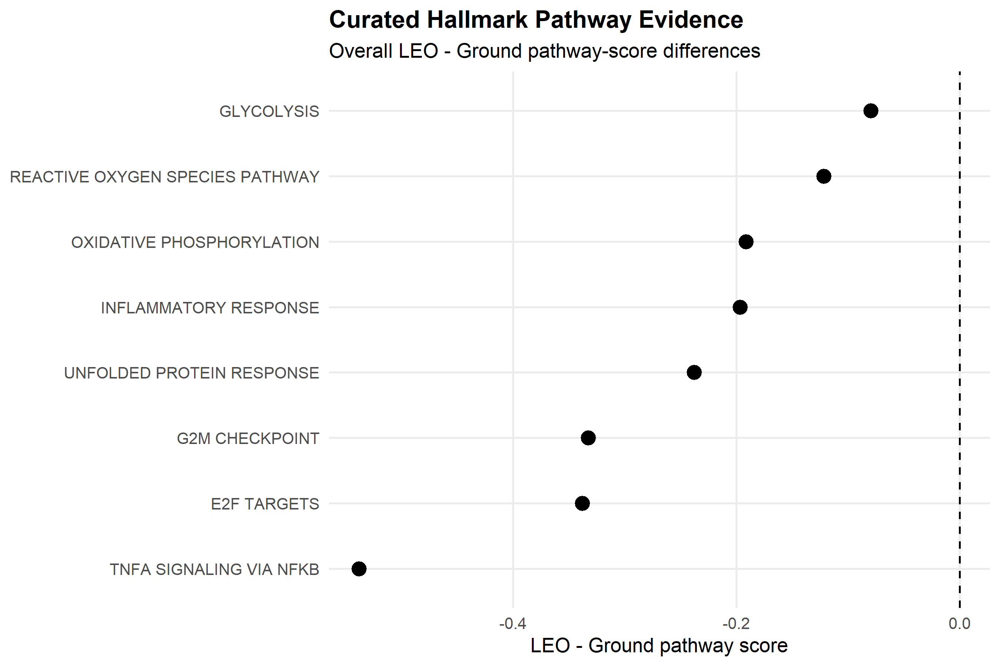

# NASA OSD-871 Maturation–Integrity Analysis

## Can a dopaminergic organoid look more mature without becoming more biologically faithful?

This project extends my original reproduction of NASA OSD-871 by testing a harder question:

**Does the LEO-associated transcriptional maturation pattern preserve dopaminergic identity and integrity, or can “maturation” diverge from biological fidelity?**

This analysis was preregistered before inspection of the final program-score results.

---

## Background

My original Build reproduced a selected published transcriptional pattern from NASA OSD-871:

- TH and DDC were consistently higher in LEO
- VIM, SOX2, PAX6, CCND1, CDKN1A and GADD45A were consistently lower

For the predefined eight-gene panel, all eight genes matched the expected published direction across four matched Ground-versus-LEO contrasts.

However, transcriptional maturation does not automatically imply functional neuronal maturation or a better Parkinson’s disease model.

This Iterate therefore separates maturation from dopaminergic fidelity.

Original Build:

[View the NASA OSD-871 Reproduction Project](https://github.com/elenipatsiala/NASA-OSD871-Reproduction)

---

# Central Question

**Does the LEO-associated transcriptional maturation phenotype represent biologically useful maturation while preserving dopaminergic identity and integrity?**

Or could the apparent maturation signal reflect:

- altered progenitor / cell-cycle state,
- cellular stress,
- lineage shifts,
- glial changes,
- or altered cell composition?

---

# Preregistered Biological Programs

Before inspecting final program scores, four literature-derived biological programs were frozen.

### 1. Neuronal Maturation

MAP2, NEFL, NEFM, SYP, SYT1, SNAP25, VAMP2, SYN1

### 2. Dopaminergic Identity / Integrity

FOXA2, LMX1A, EN1, NR4A2, PITX3, TH, DDC, SLC6A3, SLC18A2, KCNJ6

### 3. Progenitor / Cell-Cycle

SOX2, PAX6, NES, VIM, MKI67, TOP2A, CCNB2, CENPF

### 4. Cellular Stress

HSPA5, HSP90B1, DDIT3, ATF4, DNAJB1, PGK1, ARCN1, GORASP2

Astroglial and microglial markers were retained as separate annotations rather than merged into the Stress score.

All preregistered genes were present in the OSD-871 expression matrix.

---

# Scoring Method

For each gene:

1. NASA-processed normalized expression was used.
2. Expression was transformed using `log2(expression + 1)`.
3. Each gene was standardized across the 23 samples using a z-score.
4. Program scores were calculated as the equal-weight mean of the gene-level z-scores.

These scores are exploratory biological summaries.

They are **not validated biomarkers**.

---

# Overall Result

The overall LEO-versus-Ground analysis showed:

| Program | LEO-associated direction |
|---|---|
| Neuronal Maturation | ↑ |
| Dopaminergic Identity / Integrity | ↑ |
| Progenitor / Cell-Cycle | ↓ |
| Cellular Stress | ↓ |

Approximate overall LEO − Ground shifts:

- Maturation: **+0.475**
- Dopaminergic Identity: **+0.193**
- Progenitor / Cell-Cycle: **−0.586**
- Stress: **−0.606**

At the overall level, this pattern is consistent with the preregistered useful-maturation hypothesis.

---

# Flagship Result — LEO NeuroTune Map



The map keeps two biological dimensions separate:

**X-axis:** neuronal maturation  
**Y-axis:** dopaminergic identity / integrity

Arrows represent matched Ground → LEO shifts.

Three of four matched subgroups moved toward both higher maturation and higher dopaminergic identity.

However, one subgroup did not.

---

# Critical Counterexample

## Control + microglia

This subgroup showed:

- Maturation ↑
- Dopaminergic Identity ↓
- Stress ↓

This is important because it demonstrates that:

**maturation-associated transcription can increase without preservation of dopaminergic identity.**

The decrease in dopaminergic identity remained present across all leave-one-gene-out identity analyses.

This counterexample would have been hidden by looking only at the overall average.

---

# Leave-One-Gene-Out Sensitivity

To test whether the overall results depended on one individual gene, each program score was recalculated repeatedly while removing one gene at a time.

Overall directional robustness:

| Program | Direction preserved |
|---|---:|
| Maturation | 8 / 8 |
| Dopaminergic Identity | 10 / 10 |
| Progenitor / Cell-Cycle | 8 / 8 |
| Stress | 8 / 8 |

No overall directional failures occurred.



However, subgroup-level sensitivity revealed important heterogeneity.

### PD without microglia

The Dopaminergic Identity increase was preserved in 9/10 tests.

Removing **DDC** reversed the direction.

### Control without microglia

The Stress decrease was fragile.

Removing:

- HSPA5
- HSP90B1
- DDIT3
- ATF4

reversed the Stress direction.

Therefore, robustness differs across biological contexts.

---

# Pathway-Level Evidence

Selected MSigDB Hallmark pathways were scored as a secondary exploratory analysis.

This was **curated pathway scoring, not formal GSEA**.

Overall LEO-associated pathway differences included:

| Hallmark pathway | LEO − Ground |
|---|---:|
| TNFA signaling via NF-kB | −0.538 |
| E2F targets | −0.338 |
| G2M checkpoint | −0.333 |
| Unfolded protein response | −0.238 |
| Inflammatory response | −0.197 |
| Oxidative phosphorylation | −0.191 |
| Reactive oxygen species pathway | −0.122 |
| Glycolysis | −0.080 |

The reduction in E2F and G2M programs is consistent with the lower progenitor / cell-cycle score.

Lower inflammatory, TNFA/NF-kB and unfolded-protein-response scores are broadly consistent with reduced stress-associated transcription overall.

However, lower oxidative-phosphorylation signal shows why pathway changes should not simply be labelled “beneficial.”

The response may also involve metabolic remodeling or changes in cellular composition.



---

# Cross-Study Triangulation

The OSD-871 results were compared conceptually with a 2026 study using cerebral organoids exposed to 3D-clinostat-based simulated microgravity.

The studies are **not directly equivalent**:

- dopaminergic organoids ≠ cerebral organoids
- actual ISS / LEO exposure ≠ 3D clinostat
- bulk RNA-seq ≠ targeted gene/protein/neurochemical measurements

The clinostat study showed that reduced progenitor / stemness-associated expression could coexist with:

- reduced neuronal differentiation markers,
- reduced regional identity,
- lower dopamine,
- and increased GFAP.

This supports the central conclusion that:

**progenitor-marker loss alone is not sufficient evidence of useful neuronal maturation.**

See:

`02_LITERATURE_MATRIX/05_CROSS_STUDY_TRIANGULATION.md`

---

# What This Iterate Supports

The current evidence supports the following qualified interpretation:

> **NASA OSD-871 shows an overall LEO-associated transcriptional shift toward higher neuronal maturation, lower progenitor / cell-cycle state and higher dopaminergic identity, with the overall directions robust to removal of individual genes.**

However:

> **Preservation of dopaminergic identity is subgroup-dependent, and maturation-associated transcription should not be interpreted as proof of functional or biologically faithful maturation.**

---

# What This Iterate Does NOT Show

This project does not demonstrate that:

- LEO universally improves dopaminergic organoids
- microgravity itself caused the observed effects
- the organoids are functionally more mature
- dopamine release improved
- electrophysiological maturation improved
- LEO produces a better Parkinson’s disease model
- PD-specific responses can be generalized
- the program scores are validated biomarkers

---

# Core Insight

## More mature is not necessarily more faithful.

A biologically useful dopaminergic organoid model should not only show maturation-associated transcription.

It should also preserve:

- dopaminergic identity,
- appropriate lineage state,
- cellular integrity,
- and ultimately functional neuronal properties.

---

# Project Structure

```text
NASA-OSD871-Maturation-Integrity/
│
├── README.md
│
├── 02_LITERATURE_MATRIX/
│   ├── 01_MATURATION_EVIDENCE.md
│   ├── 02_DOPAMINERGIC_IDENTITY_EVIDENCE.md
│   ├── 03_PROGENITOR_CELLCYCLE_EVIDENCE.md
│   ├── 04_STRESS_GLIAL_EVIDENCE.md
│   └── 05_CROSS_STUDY_TRIANGULATION.md
│
├── 03_REVIEW/
│   ├── ITERATE_PREREGISTRATION.md
│   ├── SCORING_PREREGISTRATION.md
│   ├── ITERATE_GATE_REPORT.md
│   ├── EXPERT_ATTACK.md
│   └── FROZEN_CREATE_SPEC.md
│
├── 04_CODE/
│   ├── 01_gene_availability_check.R
│   ├── 02_program_scoring.R
│   ├── 03_maturation_integrity_map.R
│   ├── 04_maturation_integrity_map_v1.R
│   ├── 05_leave_one_gene_out_sensitivity.R
│   └── 06_pathway_evidence.R
│
├── 05_RESULTS/
│   └── main scoring, robustness and pathway tables
│
└── 06_FIGURES/
    └── final Iterate figures
